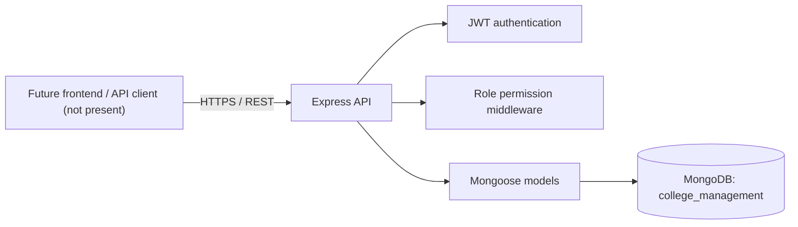
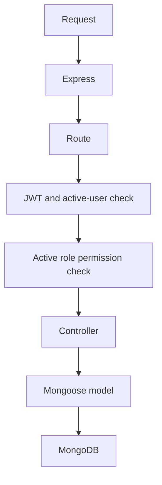

# System Architecture

**ID:** DOC-ARCH-001 
**Version:** 1.0 
**Status:** Current-state description; target decisions pending 
**Last reviewed:** 2026-11-07

## System context

The README describes a future web client consuming an Express REST API backed by MongoDB. During this audit no frontend source files were present. Existing backend source is CommonJS JavaScript with Express and Mongoose.

## Backend request flow

Express routes bind controllers and middleware. Protected routes use JWT user lookup followed by a permission-document lookup. Controllers validate request fields and call Mongoose models. There are no separate service or validator layers in the inspected source.

## Database architecture

Confirmed database name: `college_management`. Models explicitly map to users, roles, permissions, students, teachers, and subjects. README also lists candidate collections (parents, results, notices, notifications, leaves, timetables, timetable changes, system settings); no matching models were found in backend source. No database was queried as part of this governance audit. Historical read-only observations and an unexecuted Subject index plan are recorded in [backend audit](../../backend/docs/BACKEND_AUDIT.md) and [migration plan](../../backend/docs/SUBJECT_INDEX_MIGRATION_PLAN.md).

No relationship or ownership scope is implemented for department/class/parent-child access. Current permission checks are role-level.

## Authentication and authorization

Login checks an active user and password, then issues a seven-day JWT. A protected request verifies the token, loads the active user, then checks the active permission document for the required permission or `*`. Role status is not checked. Password reset, revocation, account management, fine-grained resource scoping, and role/permission administration APIs are absent.

## API conventions and errors

Current endpoints are listed in [API_DOCUMENTATION.md](../../backend/docs/API_DOCUMENTATION.md). Routes return JSON; most responses include `success`, and endpoint-specific payload keys vary. Error responses include `success: false` and a message. The backend has no separate shared response/validation module. Standardization is a quality decision, not an approved change in this audit.

## Validation, logging, operations

Validation resides in controllers and Mongoose schemas. Startup requires environment variables and waits for MongoDB. CORS allowlist and login rate limits are configurable; the limiter uses an in-memory per-process store. Errors log names/messages in several paths. Production deployment, centralized logging, monitoring, backups, and recovery procedures remain unspecified.

## Frontend architecture

The README describes React, but no frontend source or package manifest was present. Frontend is explicitly deferred until backend completion; no UI contract beyond the documented API is inferred.

## Decisions

See [ADR-001](adrs/ADR-001-existing-backend-stack.md), [ADR-002](adrs/ADR-002-database-safety.md), and [ADR-003](adrs/ADR-003-backend-first-delivery.md). This document records current architecture and is not authorization to redesign it.
